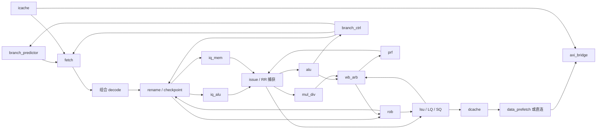

# 当前实现与接口约定

本文件描述 `verilog/filelist.f` 中的实际实现，是 RTL 接口、参数和开发流程的维护入口。实现固定为 **RV32IM、单分派、单发射、乱序执行、顺序提交**；写回和提交可以多路。RTL 使用 SystemVerilog 2005，开发监视构建器显式指定 `1800-2005` 验证语言兼容性。存储器由官方 `scripts/ram/sram_fakeram.sv` 提供，构建与综合脚本负责加入它。

## 1. 文件布局与职责

| 目录 | 文件 | 职责 |
| --- | --- | --- |
| `verilog/` | `student_top.sv`、`filelist.f` | 参数、模块连接、综合文件清单 |
| `verilog/frontend/` | `fetch.sv`、`icache.sv` | PC、取指队列、generation 过滤、指令缓存 |
| 同上 | `decode.sv`、`branch_predictor.sv` | 组合译码；BTB、BHT 与全局历史预测 |
| `verilog/backend/` | `rename.sv`、`prf.sv` | RAT、物理寄存器分配、就绪位、检查点；物理寄存器值 |
| 同上 | `iq_core.sv`、`iq_alu.sv`、`iq_mem.sv` | 共用年龄关系、唤醒和选择；ALU 与访存队列适配 |
| 同上 | `issue.sv` | 每周期选择一条候选，读取两个操作数，保持各执行单元入口 |
| 同上 | `wb_arb.sv`、`rob.sv`、`branch_ctrl.sv` | 写回仲裁、顺序提交、Store 授权；预测校验、恢复和训练 |
| `verilog/execute/` | `alu.sv`、`mul_div.sv` | 整数/控制流；乘除法 |
| `verilog/memory/` | `lsu.sv`、`dcache.sv` | 地址生成、LQ/SQ、Store 提交队列、转发；数据缓存 |
| 同上 | `data_prefetch.sv`、`axi_bridge.sv` | 三槽下一行预取；读写事务队列及外部总线 |
| `verilog/common/` | `pc_increment.sv`、`word_adder.sv`、`word_compare.sv`、`signal_fanout.sv` | 地址增量、分组运算和控制信号分发 |
| `tb/monitor/` | `ipc_stats.sv`、`branch_stats_monitor.sv`、`branch_stats_bind.sv` | 仅仿真的性能计数和分支统计 |
| `scripts/dev/` | `instrumentation.py`、`ipc_profile.py`、`branch_accuracy.py`、`report.py` | 性能构建、采集和手动报告 |

`tb/` 中的单元测试、定向测试、等价检查和运行器已删除，仅保留上述监视器。监视器不进入 `filelist.f`，也不进入综合。`testcases/` 的官方程序集保留。

官方工具仍位于 `scripts/`：`build.py`、`run.py`、`testcase.py`、`sim.cpp`、`oj_io.py`、`fakeram.py`、`toolchain.py`、`synth.py`、`synth_report.py`、`timing.py`、`timing.tcl` 和 `ram/sram_fakeram.sv`。开发工具统一放在 `scripts/dev/`，输出默认放在 `build/`。

## 2. 配置边界

顶层参数如下。宽度、ID 位数和 payload 总位数由容量自动推导，是模块内部 `localparam`，不能单独覆盖。

| 参数 | 默认 | 支持范围 / 约束 |
| --- | ---: | --- |
| `WB_WIDTH` | 2 | 1、2、3；物理写口与 ROB 完成通道数 |
| `COMMIT_WIDTH` | 2 | 1 至 `ROB_DEPTH`；顺序提交上限 |
| `ROB_DEPTH` | 32 | 不小于 2 的 2 次幂 |
| `PRF_SIZE` | 48 | 大于 32；可非 2 次幂 |
| `IQ_ALU_DEPTH` / `IQ_MEM_DEPTH` | 7 / 4 | 正整数；可非 2 次幂 |
| `LQ_DEPTH` | 4 | 正整数；可非 2 次幂 |
| `SQ_DEPTH` | 8 | 不小于 2 的 2 次幂；提交 ticket 依赖模运算 |
| `CHECKPOINT_DEPTH` | 4 | 正整数；可非 2 次幂 |
| `FETCH_QUEUE_DEPTH` | 16 | 不小于 2 的 2 次幂 |
| `IFETCH_OUTSTANDING` | 8 | 1 至 `FETCH_QUEUE_DEPTH` |
| `LOAD_OUTSTANDING` | 4 | 正整数；包括已取消但尚未返回的读事务 |
| `AXI_RD_OUTSTANDING` | 16 | 正整数；取指与数据读共享 |
| `ICACHE_SIZE_BYTES` / `DCACHE_SIZE_BYTES` | 1024 / 16384 | `WAYS × LINE_BYTES × SETS`，`SETS` 为正的 2 次幂 |
| `ICACHE_WAYS` / `DCACHE_WAYS` | 2 / 2 | 1、2、4 |
| `ICACHE_LINE_BYTES` / `DCACHE_LINE_BYTES` | 32 / 64 | 16 至 512 的 2 次幂 |
| `BP_ENABLE` / `DATA_PREFETCH` | 1 / 1 | 0 或 1；保留功能开关 |
| `BTB_ENTRIES` | 32 | 2 至 2^29 的 2 次幂 |
| `BHT_ENTRIES` | 256 | 2 至 2^30 的 2 次幂 |
| `GEN_WIDTH` | 16 | 正整数；在旧事务排空前必须避免 generation 重用 |
| `RESET_PC` | `32'h00000000` | 32 位、4 字节对齐 |

非法顶层组合在 elaboration/仿真初始化时报错。合法组合不会产生这些检查的硬件。表中范围表达结构约束；组合的实际面积和仿真成本随容量增长，回归覆盖见第 10 节。

单分派和单发射没有参数：`DISPATCH_WIDTH`、`ISSUE_WIDTH` 已移除。decode/fetch/dispatch 的 count 字段保留 1 位，合法有效包的 count 为 1；无效周期的 payload/count 不用于分配。

下列实现选择固定为当前路径：直接单条 rename、SRAM 检查点、顺序关系 IQ 选择、单条 issue、SRAM PRF、寄存 ALU 结果、独立分支解析、直接写回、LSU 请求/响应旁路、已提交 Store 缓冲、D-cache miss 下命中及部分 refill 命中、三槽预取和定向失效、全局历史预测。旧 wrapper、备用调度器、独立 operand-read、候选流水线和相关实验开关已删除。

`iq_core.MEM_QUEUE` 区分 ALU 队列与访存队列的 Store 就绪规则；`UOP_BITS` 和字段偏移用于这两种 payload 的适配。`rename.WAKE_WIDTH` 表示完成唤醒数，顶层固定接三源；它与 `WB_WIDTH` 不同。`dcache.BULK_REFILL` 由顶层 `DATA_PREFETCH` 连接。`axi_bridge` 直接使用 `LD_ID_WIDTH` / `IF_ID_WIDTH` 表示事务 ID 位数，不再借用队列深度表示它们；写队列容量在顶层固定为 16。

## 3. 主数据流与时序



取指使用缓存 SRAM 与队列，空队列可以旁路输出。decode 是组合逻辑，没有额外的 decode 寄存级；rename 直接在同一个 dispatch 边沿更新 RAT、ROB、IQ、LSQ 和检查点。队列唤醒后选出候选，issue 每周期最多捕获一条指令的寄存器编号和两个值。ALU、MUL、MEM 三个保持槽分别服务执行单元，允许先前发出的操作重叠，但不增加每周期发射数。

ALU 结果寄存后参与完成仲裁，乘除法和访存具有各自的多周期状态。写回直接送到 PRF 和 ROB；ROB 依据已完成位从 head 提交连续前缀。普通指令的本周期写回在边沿更新完成位，下一周期可提交；head Store 授权额外检查本周期完成通道。

分支解析使用 RR 槽的独立操作数路径，每条控制流指令只宣布一次，且不等待结果写回仲裁。ALU 给出真实 next-PC，`branch_ctrl` 校验检查点后发出恢复、重定向和训练。这些路径有旁路与独立状态，不能用一条固定阶段数来代表所有指令延迟。

## 4. 通用握手、编号与压紧布局

- 普通请求以 `valid && ready` 在上升沿完成接收；未接收时发送端保持有效请求的身份和内容。执行结果在回压时由执行单元/LSU 保持。
- IQ 的 `cand_take` 是候选消费事件。顶层 `disp_fire = disp_valid && disp_ready` 是唯一架构分配事件；各队列只能在它发生时将 prepared 数据标为有效。
- `disp_prepare`、资源充足时的 SRAM/数组预写、地址/恢复预览都可以早于 fire，不能据此更新有效位或资源计数。
- `*_rsp_valid`、resolve、训练、Store 授权/完成是事件信号，没有独立 ready。接收模块负责无损消费或内部保持。
- clock 上升沿更新状态，reset 为高有效同步复位。有效位复位后，未初始化的无效 payload 不可作为有效事务使用。
- 多路扁平总线的第 0 路位于最低位：`payload[lane*BITS +: BITS]`。提交路由从最老到较新排列。
- ROB tag 是环形下标；年龄为固定 `RW` 位的 `tag - rob_head`。squash 保留触发分支及更老指令，丢弃严格更年轻的指令。
- 请求身份用 `{generation, id}`；generation 不是外部 AXI ID。缓存 refill 和桥内队列保存原请求身份，返回时原样携带。

记 `W(n)=max(1,ceil(log2(n)))`：`RW=W(ROB_DEPTH)`、`PW=W(PRF_SIZE)`、`LIDW=W(LQ_DEPTH)`、`SIDW=W(SQ_DEPTH)`、`FIDW=W(FETCH_QUEUE_DEPTH)`、`CIDW=W(CHECKPOINT_DEPTH)`、`MIDW=max(LIDW,SIDW)`、`G=GEN_WIDTH`。资源计数宽度为 `ceil(log2(DEPTH+1))`。`IFID=log2(ICACHE_LINE_BYTES/4)`，`DCID=log2(DCACHE_LINE_BYTES/4)`。

以下 payload 均按 **高位到低位** 列出，方括号为字段宽度。默认 `RW=5, PW=6, LIDW=2, SIDW=3, FIDW=4, CIDW=2, MIDW=3, G=16, IFID=3, DCID=4`。

| 通道 / payload | 字段：高位 → 低位 | 位数公式 | 默认 |
| --- | --- | --- | ---: |
| fetch packet | `pc[32], inst[32], pred_npc[32]` | 96 | 96 |
| decode uop | `pc[32], pred_npc[32], op[6], rs1[5], rs2[5], rd[5], imm[32]` | 117 | 117 |
| ROB alloc | `old_pdst[PW], kind[2], sq_id[SIDW]` | `PW+2+SIDW` | 11 |
| ALU IQ | `rob[RW], cp[CIDW], op[6], pdst[PW], psrc1[PW], psrc2[PW], pc[32], imm[32]` | `RW+CIDW+6+3*PW+64` | 95 |
| MEM IQ | `rob[RW], mem_op[3], mem_id[MIDW], psrc1[PW], psrc2[PW], imm[32]` | `RW+3+MIDW+2*PW+32` | 55 |
| LSQ alloc | `is_store[1], mem_id[MIDW], rob[RW], pdst[PW]` | `1+MIDW+RW+PW` | 15 |
| checkpoint alloc | `cp[CIDW], rob[RW], pred_npc[32]` | `CIDW+RW+32` | 39 |
| ALU execute | `rob[RW], cp[CIDW], op[6], pdst[PW], pc[32], imm[32], a[32], b[32]` | `RW+CIDW+6+PW+128` | 147 |
| MUL execute | `rob[RW], mul_op[3], pdst[PW], a[32], b[32]` | `RW+3+PW+64` | 78 |
| MEM execute | `rob[RW], mem_op[3], mem_id[MIDW], base[32], imm[32], data[32]` | `RW+3+MIDW+96` | 107 |
| FU result | `rob[RW], pdst[PW], value[32]` | `RW+PW+32` | 43 |
| branch resolve | `rob[RW], cp[CIDW], pc[32], conditional[1], taken[1], target[32], npc[32]` | `RW+CIDW+98` | 105 |
| predictor train | `pc[32], conditional[1], taken[1], target[32]` | 66 | 66 |
| fetch redirect | `pc[32], generation[G]` | `32+G` | 48 |
| register commit | `old_pdst[PW]` | `PW` | 6 |
| fetch ↔ I-cache | `generation[G], fetch_id[FIDW], count[1], addr/inst[32]` | `G+FIDW+1+32` | 53 |
| I-cache ↔ AXI bridge | `generation[G], word_id[IFID], addr/data[32]` | `G+IFID+32` | 51 |
| LSU ↔ D-cache load | `generation[G], lq_id[LIDW], addr/data[32]` | `G+LIDW+32` | 50 |
| D-cache ↔ memory load | `generation[G], word_id[DCID], addr/data[32]` | `G+DCID+32` | 52 |
| prefetch ↔ AXI bridge load | `generation[G], slot[2], word_id[DCID], addr/data[32]` | `G+2+DCID+32` | 54 |
| Store / writeback | `addr[32], data[32], strb[4]` | 68 | 68 |

`DATA_PREFETCH=0` 时 D-cache load 通道直接接桥，`LD_ID_WIDTH=DCID`；启用时为 `DCID+2`，slot=0 表示 demand，slot=1/2/3 表示三个预取槽。整行 refill 通道 `line_req_valid/ready` 不另带地址，使用同周期 D-cache memory load payload 的行地址；`line_rsp_data` 为 `DCACHE_LINE_BYTES*8` 位，低位对应行内最低地址的字。

译码内部 op 编号如下，属于模块间协议，不是 RISC-V 指令编码。

| op | 顺序映射 |
| --- | --- |
| 0–10 | NOP, LUI, AUIPC, JAL, JALR, BEQ, BNE, BLT, BGE, BLTU, BGEU |
| 11–19 | ADDI, SLTI, SLTIU, XORI, ORI, ANDI, SLLI, SRLI, SRAI |
| 20–29 | ADD, SUB, SLL, SLT, SLTU, XOR, SRL, SRA, OR, AND |
| 30–37 | LB, LH, LW, LBU, LHU, SB, SH, SW |
| 38–45 | MUL, MULH, MULHSU, MULHU, DIV, DIVU, REM, REMU |

`mem_op=op-30`、`mul_op=op-38`。ROB kind：0 普通，1 控制流，2 Load，3 Store。未使用的源寄存器置 0；architectural x0、physical 0 始终为零，`rd=0` 不分配物理目的寄存器。

## 5. rename、IQ、操作数与写回

rename 在 reset 时建立 32 个 architectural register 的初始物理映射，其余寄存器进入 free 集合。目的寄存器分配、RAT 更新、目的 ready 清除与 dispatch 原子发生。ROB 保存旧映射，提交时回收 `old_pdst`，不是当前目的寄存器。完成唤醒把物理目的标记为 ready。

每个控制流检查点保存包含该指令目的更新后的 RAT，以及后续物理分配集合。RAT 检查点分银行存入 SRAM；读数据提前准备，最近一次写入的检查点通过旁路恢复。因此 squash 边沿可以直接恢复 RAT，并回收更年轻的物理分配，不增加恢复等待状态。释放 mask 同时维护 rename 与 branch_ctrl 的检查点有效状态。

`iq_alu` 与 `iq_mem` 共用 `iq_core` 的 entry、源就绪、年龄关系和选择实现。普通候选要求两个实际使用的源 ready。Store 可以在 base ready 后先生成地址，data readiness 独立携带，由 issue/LSU 后续补齐；Load 按其源要求选择。两个队列各提供最老可用候选，issue 在可接收的候选之间按 ROB 年龄选一条。

PRF 有两个读口和 `WB_WIDTH` 个写口，存储值使用 SRAM，读出有先前写回的旁路。issue 另保留当前/上一周期完成转发；操作数值即使执行单元回压，也会在保持槽中更新。完成源顺序固定为 ALU=0、MUL=1、LSU=2，与物理写回路数无关。

rename 接三源完成唤醒；IQ 接三源完成唤醒加一源 ALU 提前唤醒。ALU 的提前唤醒领先寄存结果一个周期，后续实际值由执行转发提供。当前 LSU 结果仅进入 Store data 的同周期转发；其他操作数以及分支使用上一周期 LSU 值，避免形成 LSU 请求/结果到选择的反馈路径。

`wb_arb` 每周期接受最多 `WB_WIDTH` 个三源结果。宽度不小于 2 时第 0 路优先接受 ALU，其余按轮转选择；宽度 1 时三源轮转。每个源最多被选一次。被 squash 的年轻结果仍可被消费，但不置 `done_valid` / `write_valid`。非零 pdst 才写 PRF；pdst=0 的有效完成仍更新 ROB。仲裁后的完成通道和写口数都不超过配置值。

## 6. 控制流、ROB 与 Store 提交

预测器采用 BTB、2 位 BHT 和固定 8 位全局历史，BTB 的值存储使用 SRAM。`BP_ENABLE=0` 时输出顺序 next-PC。fetch 把预测 next-PC 放进 packet；rename 对非控制流却预测成跳转的情况发出前端修正，不触发后端 squash。

`branch_ctrl` 仅接受 cp 有效、cp ID 在范围内且 cp ROB tag 匹配的 resolve。比较真实 npc 与保存的 pred_npc，错误时恢复该检查点、释放该检查点及更年轻检查点、保留触发分支和更老指令。正确解析释放自身检查点。匹配解析才训练预测器，失效检查点的旧结果不能训练或重定向。后端 mispredict 重定向优先于前端修正；每次重定向将 generation 加 1。

ROB 维护环形 head/tail、有效占用、完成位和 Store 授权/应答状态。每周期提交最多 `COMMIT_WIDTH` 条连续最老完成指令；遇到未完成项停止。squash 同周期可以提交保留范围内的旧指令，不得跨越触发分支删除范围。

Store 地址和数据准备完后先报告 FU 完成；只有已完成且位于 ROB head 的 Store 才发 `st_start_valid/st_start_id`，每条仅授权一次。RAM Store 交给 LSU 已提交 FIFO 后，同周期 `st_done_valid` 允许它退休，随后连续的普通完成指令也可以退休；提交前缀中的第二个 Store 要等成为 head 再授权。非 RAM Store 等真实外部写响应后退休。

已提交 Store 的 SQ 项直到 D-cache 返回写完成才释放，FIFO 保持写入顺序且跨 squash 保留。其转发年龄按 Store 提交 ticket 计算，避免原 ROB 下标重用后的错误比较。ROB 退休并不表示 RAM Store 已经写到外部存储器。

## 7. LSU、缓存与外部事务

LSU 分派时分配 LQ/SQ 项；AGU 计算 `base+imm`。访存请求按字地址发送，SB/SH/SW 根据 byte offset 左移数据并生成 strobe，Load 根据 offset 和 mem_op 扩展有符号/无符号结果。软件应使用自然对齐访问；实现没有跨字拼接或 misalignment trap。

Load 检查所有更老未提交 Store 与已提交 Store。存在未知地址 Store 时等待；地址重叠时，仅在最新重叠 Store 覆盖完整 Load 字节集合且数据 ready 时转发，否则等待。Load 可通过空请求缓冲直接向缓存发请求；有回压则锁存 generation、ID 和地址。缓存响应优先产生完成，LSU 的结果保持缓冲处理写回回压。

LQ 返回匹配同时要求 entry 有效、等待响应状态、ID 和 generation 相同。squash 不能取消已经发到缓存/桥的事务：所有真实读响应都归还 outstanding credit，失效响应不得写入重用的 LQ 项或产生完成。MEM 地址预览允许 squash 边沿接受读请求，其返回仍带原 generation 并被过滤。

I-cache 接收 fetch queue ID，miss 时按行内字编号 refill，命中经 SRAM 返回。取指重定向不会撤销已经启动的物理 refill，fetch 按 generation 忽略旧逻辑响应。D-cache 为 write-back/write-allocate：脏替换先写回再 refill；支持 refill 期间其他已缓存行的 Load 命中，以及当前行已返回字的 Load 命中，冲突请求内部保持/重试。Store 命中可连续流水，mask 只修改相应字节。

数据预取使用三个下一行槽，只在没有外部 demand 请求时发预取；缓存行数据保存在 SRAM。完整预取行可通过整行接口 refill，部分行可按字提供。D-cache 向桥发送的写请求握手时，`write_fire/write_addr` 按地址定向失效相同预取行，覆盖脏行写回和 I/O 写；已经发出的旧预取须排空，不能让旧数据重新变为命中。`DATA_PREFETCH=0` 时顶层直接连接 D-cache 与桥，关闭整行预取接口。

RAM 地址范围为 `0x00000000..0x0fffffff`，按 little-endian 访问。非 RAM Load 返回零，不发外部读；非 RAM Store 进入 I/O 路径，D-cache 先排空脏数据，再发送写事务。官方模拟器使用 `SW 0x80000000` 作为程序结果/退出写，结果完成需经过外部写响应；不加入 CSR、中断、异常或 MMU 接口。

顶层外部端口保持原协议，方向相对 CPU：

| 组 | CPU 输出 | CPU 输入 |
| --- | --- | --- |
| 时钟/复位 | — | `clock, reset` |
| 读地址 | `araddr[32], arvalid` | `arready` |
| 读返回 | `rready` | `rdata[32], rresp[2], rvalid` |
| 写地址 | `awaddr[32], awvalid` | `awready` |
| 写数据 | `wdata[32], wstrb[4], wvalid` | `wready` |
| 写返回 | `bready` | `bresp[2], bvalid` |

这是课程环境的无 ID、无 burst 五通道接口。桥在取指和数据读之间轮转，把 generation/ID 存入共享 FIFO；AR 可以有多笔 outstanding，R 必须按 AR 接收顺序返回。AW/W 独立握手，分别按写队列顺序发出，B 在对应 AW 和 W 都接收后才能消费，并须按写入顺序返回。reset 时环境应同步清空在途事务。当前实现不处理 `rresp/bresp` 错误，环境应提供成功响应。

## 8. 性能监视与输出

普通 `make build/test/perf/synth` 不编译 monitor。开发构建器在 filelist 之外加入三个 monitor，以 `bind` 接当前顶层和 branch_ctrl；启用断言并继续使用 SystemVerilog 2005。`sim.json` 保存参数覆盖、语言和输入 SHA-256，防止复用普通无监视器二进制或把不明配置当作本次结果。

`ipc_stats.sv` 在非 reset 上升沿累计 dispatched、issued、retired、空候选、发射回压、前端/rename/队列阻塞、head Load/Store 等待、mispredict、缓存等待和 WB 冲突。阻塞计数可以重叠，不能相加当作总停顿。它同时检查每周期单分派、单发射以及 WB/commit 上限。输出到 stderr 的 `CPU2026 ipc_profile ...` 保留原计数字段。

IPC 的程序指令数来自官方 workload 信息；分母使用模拟器报告的 `CPU2026 cycles`。monitor 的 cycles 是其采样次数，独立记录。issued/dispatched 可以包含后来被取消的指令，不作为程序动态指令数。性能汇总保留逐程序 cycles/instructions/IPC 和几何平均 IPC。

分支监视以检查点匹配的存活解析为统计事件，按 PC 与 conditional/jump 分组。正确条件是 **真实 next-PC 等于预测 next-PC**，所以同时包含方向和目标正确性。已解析但随后被更老分支取消的事件不会追溯删除；这不是最终退休分支统计。stderr 协议保留 `version=1 scope=resolved_next_pc`；JSON、CSV 记录 predictions、correct、taken、taken_correct 及准确率。

| 入口 | 输出 |
| --- | --- |
| `make ipc-profile` | `IPC_STATS_OUT`，默认 `$(BUILD)/ipc-profile`；`profile.json`、`sim.json`、`build.log`、逐程序 stdout/stderr、监视仿真器 |
| `make branch-accuracy` | `BP_STATS_OUT`，默认 `$(BUILD)/branch-accuracy`；汇总 JSON/CSV、逐 PC CSV、构建与程序日志 |
| `make report` | `REPORT_OUT`，默认 `$(BUILD)/reports`；时间戳/commit 命名的文本报告和对应 `.build` 目录 |
| `make synth` | `SYNTH_OUT/MODE`，默认 `build/synth/opt`；面积、时序和完整工具日志 |

性能脚本比较程序期望输出、检查 stderr 协议和 cycles；失败写入报告并返回非零。分支脚本默认跑 correctness+perf，IPC 脚本默认只跑 perf。`--kind all` 可让 IPC 脚本执行完整官方程序集，`--case` 可重复指定多个程序。

## 9. 构建、回归与报告流程

从仓库根目录运行，已有 `cpu2026:latest` 镜像时可用下列 Docker 命令；容器内 `APPIMAGE=` 使用镜像自带工具。

```sh
docker run --rm --network none --user "$(id -u):$(id -g)" \
  --mount "type=bind,source=$PWD,target=/work" --workdir /work \
  cpu2026:latest make test APPIMAGE= MAX_CYCLES=100000000 JOBS=2
```

在相同容器环境中依次执行：

```sh
make perf APPIMAGE= MAX_CYCLES=100000000 SIM=/work/build/sim
make ipc-profile APPIMAGE= JOBS=2
make branch-accuracy APPIMAGE= Case=perf_qsort JOBS=2
make synth APPIMAGE=
```

`make test/perf` 使用官方 `scripts/testcase.py`。默认 `MAX_CYCLES=1000000` 不足以完成所有长 correctness 程序，完整回归须显式提高；开发性能入口默认 `BP_MAX_CYCLES=100000000`。`SIM=...` 可以复用已构建普通仿真器；官方 `make build` 不接受 RTL 参数覆盖。

参数比较使用监视构建器，不新增 tb 测试：

```sh
make ipc-profile APPIMAGE= Case=perf_qsort \
  PARAMETERS="WB_WIDTH=1 COMMIT_WIDTH=4" IPC_STATS_OUT=build/wb1-commit4
python3 scripts/dev/ipc_profile.py --appimage '' --kind all --jobs 2 \
  --parameter WB_WIDTH=3 --parameter COMMIT_WIDTH=1 --out build/wb3-commit1
make branch-accuracy APPIMAGE= BP_WB_WIDTH=1 BP_COMMIT_WIDTH=2 BP_ENABLE=0
```

参数只允许顶层实际声明的名称，值为十进制或 `0x` 十六进制整数；未知、重复和已删除参数报错。IPC 的 `--sim` 只接受同目录有 `sim.json` 的监视器二进制，复用时不能同时指定参数覆盖。

在宿主机运行 `make report JOBS=2`，会手动、顺序启动 Docker 完成 correctness → perf → IPC → synth；任何一项失败仍保留该项日志，最终返回非零。报告记录 commit、工作区状态及当前源码散列，包含未提交的重构代码。`.githooks/post-commit` 已删除，仓库本地 `core.hooksPath=.githooks` 已取消；提交不再自动触发构建或报告。

`make` / `make code` 保留 OJ 的 `./code` 入口。原 `test-icache`、分支单元测试和 timing 单元测试入口已移除；综合时序仍由官方 synth/timing 工具产生。修改 RTL 后必须通过 `make synth`，并检查面积和时序报告；当前重构不另设 MHz 验收门槛。

## 10. 重构验收与维护

基线源码、普通仿真结果、监视结果和综合报告保存在 `build/refactor/baseline/`。最终验收输出位于 `build/refactor/final/`；这些是本次运行产物，不是新建的仓库测试框架。

验收比较默认配置下全部 correctness 输出/周期、六个 perf 的周期/IPC，以及监视器行为。配置矩阵覆盖 `WB_WIDTH={1,2,3}` × `COMMIT_WIDTH={1,2,4}`、预测/预取四种组合（默认组合复用）、较小和较大容量；每个配置运行现有 19 个 correctness 和 6 个 perf 程序。容量配置包含非 2 次幂 IQ/LQ，以及 1/2/4-way 缓存和不同 cache line 大小。

本次 Docker 回归中，14 组配置的 350 次程序运行全部通过；最小容量配置另通过 3 个程序，覆盖 ROB=2、PRF=33、IQ/LQ/检查点深度=1、SQ=2 和单 cache set。11 个非法参数组合均被拒绝。默认 19 项正确性周期、6 项性能周期/IPC、原有 IPC 阻塞计数及逐 PC 分支统计与基线逐项一致。官方构建、开发监视构建和分支统计入口均已通过。手动 `make report` 也已实测，test、perf、ipc-profile、synth 四项均为 PASS，报告保存在 `build/refactor/manual-report/`。

| 默认配置指标 | 基线 | 重构后 |
| --- | ---: | ---: |
| 六项性能几何平均 IPC | 0.8142 | 0.8142 |
| 综合总面积（um²） | 17984.779 | 17993.265 |
| 估计最高频率（MHz） | 172.55 | 192.30 |
| 5 ns 目标下最差 setup slack（ns） | -0.7951 | -0.1999 |

`make synth` 已通过；上述 slack 仍为负值，时序数据作为测量结果保留。逐配置结果见 `build/refactor/final/matrix.json`，基线比较见 `build/refactor/final/comparison.json`，综合细节见 `build/refactor/final/synth/opt/report.txt`。RTL 源码由 5175 行精简至 3923 行，统计不包含 monitor 和官方 SRAM 模型。

维护时先修改对应功能目录，再同步本文件的参数、payload 和时序约定，最后运行官方程序、性能监视和综合。现有程序回归不等同于旧单元/形式测试的全部边界覆盖；要扩展覆盖时使用新的程序或临时分析产物，避免重新混入已删除的 tb 测试。
